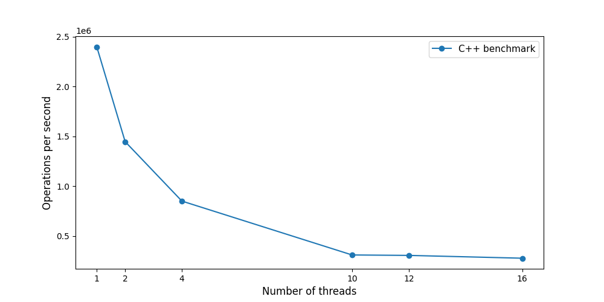

**Multithreaded C++ In-memory key-value storage**
- 

A high-performance, thread-safe, in-memory key value store built with modern C++. Designed as systems programming project demonstrating reader-writer lock synchronization, cooperative thread cancellation via RAII, TTL-based eviction, and automated performance benchmarking.

**Key features:**

- High Concurrency: Implements a reader-writer lock pattern using `std::shared_mutex` to allow concurrent readers while guaranteeing exclusive access for writers.
- Modern C++ Abstractions: Leverages `std::optional` for clean value handling without magic return types, monotonic clocks for drift-free TTL management and `noexcept` and `[[nodiscard]]` specifiers.
- Asynchronous cleanup: Background thread using `std::jthread` and `std::stop_token` to automatically evict expired keys without blocking active reads/writes.
- Automated benchmarking: CLI library (`kvstore_bench`) emitting structure JSON output, wrapped by a Python automation script (`python_benchmark.py`) to chart throughput metrics.


**Architecture and concurrency model**

*Synchronization strategy:*
- Read operations: Acquire `std::shared_lock<std::shared_mutex>`, allowing multiple threads to query keys in parallel without contention.
- Write/delete operations: Acquire `std::unique_lock<std::shared_mutex>`, blocking all other readers and writers to maintain consistency.

*Background eviction:*
- Thread safety: Uses `std::jthread` to encapsulate lifecycle management. Thread destruction automatically triggers cooperative cancellation via `std::stop_token` and executes `join()`.
- Clock monotonicity: Uses `std::chrono::steady_clock` to prevent TTL calculation errors caused by system time adjustments.

**Project Structure**
```text
├── benchmark/
│   └── benchmark_python.py # Python automation & chart generation script
├── include/kvstore/
│   ├── kvstore.h         # Core thread-safe Key-Value Store interface
│   └── ttl_worker.h      # Asynchronous TTL eviction worker
├── src/
│   ├── benchmark_cli.cpp # C++ CLI executable for bench metrics (JSON output)
│   ├── kvstore.cpp       # C++ implementation of library/classes
│   └── main.cpp          # Demo usage
├── CMakeLists.txt        # Modular CMake build configuration
└── README.md
```

**Building and Running**

*Prerequisites:*
- C++20 compiler
- CMake 3.50+
- Python 3.8+ (with `matplotlib` and `pandas`)

*Build instructions:*

```bash
git clone [https://github.com/Orleann/kvstore.git](https://github.com/Orleann/kvstore.git)
cd kvstore


mkdir build && cd build
cmake ..
make -j
```

*Running demo:*

```bash
./kvstore
```

*Running benchmark:*

```bash
python3 benchmark/benchmark_python.py
```
